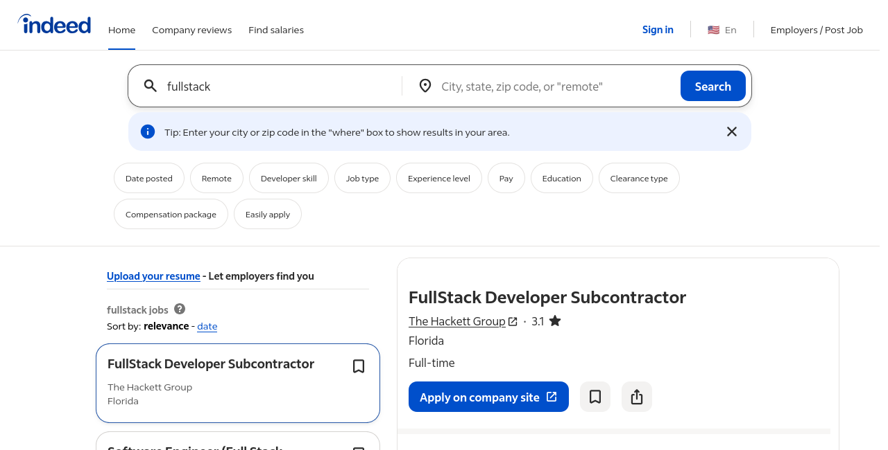
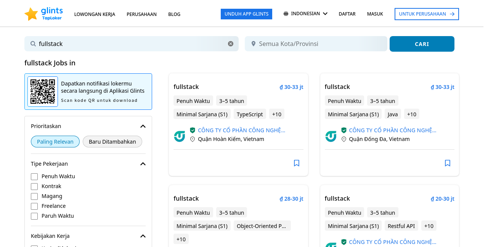

# Stryx

> Multi-Purpose Web Scraping Engine for Modern Web Content Extraction

`Stryx` is a multi-purpose web scraping engine designed to reliably fetch complete, hydrated HTML content across modern web targets. Whether extracting job listings, discussion threads, developer forum comments, or repository issues, Stryx adapts automatically to deliver full web page content.

---

## Screen Capture Evidence

Evidence captured during live extraction, cropped to active content viewports demonstrating fully rendered page states:

<p align="center">
  
  
</p>
<p align="center">
  
  
</p>
<p align="center">
  
</p>

---

## Multi-Purpose Target Coverage

Stryx has been verified across diverse web platforms for multiple data extraction use-cases:

| Target Platform | URL Tested | Data Type Extracted | Content Size | Status |
|---|---|---|---|---|
| **LinkedIn** | `linkedin.com/jobs/search` | Job listings & search results | 301 KB | **SUCCESS** |
| **RemoteOK** | `remoteok.com/remote-jobs` | Remote engineering job cards | 58 KB | **SUCCESS** |
| **Glints** | `glints.com/opportunities` | Career postings & company data | 770 KB | **SUCCESS** |
| **Indeed** | `indeed.com/jobs` | Job search results & company cards | 1.1 MB | **SUCCESS** |
| **JobStreet** | `id.jobstreet.com/jobs` | Regional tech opportunities | 981 KB | **SUCCESS** |
| **Nodeflair** | `nodeflair.com/jobs` | Tech salary & job cards | 135 KB | **SUCCESS** |
| **Reddit** | `reddit.com/r/.../comments` | Community posts & user discussions | 126 KB | **SUCCESS** |
| **GitHub** | `github.com/.../issues` | Issue threads & comment history | 231 KB | **SUCCESS** |
| **HackerRank** | `hackerrank.com/challenges/...` | Problem statements & forum threads | 217 KB | **SUCCESS** |
| **Ashby** | `ashbyhq.com` | Company directory & career pages | 226 KB | **SUCCESS** |

---

## Getting Started

### Prerequisites

- Node.js 20+
- pnpm 9+

### Setup

```bash
git clone https://github.com/stryxlab/stryx.git
cd stryx
pnpm install
pnpm build
```

---

## Usage Guide

Run Stryx directly via the command line interface to fetch full HTML content and save it to disk.

### 1. Basic Command Syntax

```bash
pnpm cli <url> [options]
```

### 2. Available Options

| Flag | Description | Default |
|---|---|---|
| `--output <file>` | Custom file path to save the HTML document | Auto-generated in `./output/<domain-slug>.html` |
| `--timeout <ms>` | Maximum request timeout in milliseconds | `30000` |

---

### 3. Practical Usage Examples

#### Scrape LinkedIn Job Search
```bash
pnpm cli "https://www.linkedin.com/jobs/search?keywords=fullstack" --output linkedin-jobs.html
```

#### Scrape RemoteOK Listings
```bash
pnpm cli "https://remoteok.com/remote-fullstack-jobs" --output remoteok.html
```

#### Scrape Glints Career Posts
```bash
pnpm cli "https://glints.com/id/opportunities/jobs/explore?keyword=fullstack" --output glints.html
```

#### Scrape Indeed Job Cards
```bash
pnpm cli "https://www.indeed.com/jobs?q=fullstack" --output indeed.html
```

#### Scrape JobStreet Opportunities
```bash
pnpm cli "https://id.jobstreet.com/id/job-search/fullstack-jobs/" --output jobstreet.html
```

#### Scrape Reddit Discussion & Comments
```bash
pnpm cli "https://www.reddit.com/r/programming/comments/" --output reddit-comments.html
```

#### Scrape GitHub Issues & Discussions
```bash
pnpm cli "https://github.com/microsoft/playwright/issues/1000" --output github-issue.html
```

#### Scrape HackerRank Challenges & Forum
```bash
pnpm cli "https://www.hackerrank.com/challenges/simple-array-sum/forum" --output hackerrank.html
```

#### Scrape Ashby Career Pages
```bash
pnpm cli "https://www.ashbyhq.com" --output ashby.html
```

---

## Repository Structure

```text
stryx/
├── stryx-cli/         # Command-line interface runner
├── stryx-core/        # Multi-purpose orchestration engine
├── stryx-domain/      # Shared interfaces and data contracts
├── stryx-transport/   # Direct network client
├── stryx-browser/     # Browser rendering client
├── stryx-detector/    # Page state analyzer
├── stryx-solver/      # Adaptive resolution room
└── stryx-cache/       # Session and cookie persistence
```

---

## License

MIT
